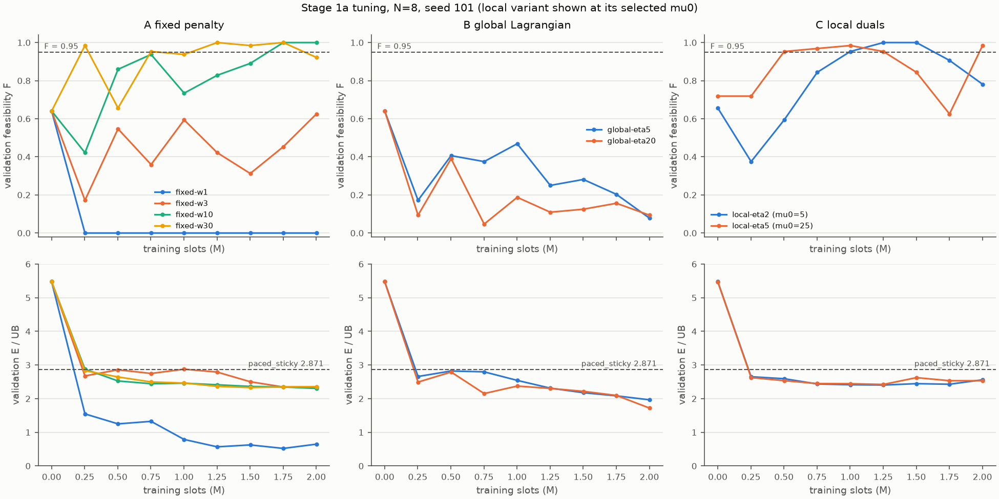
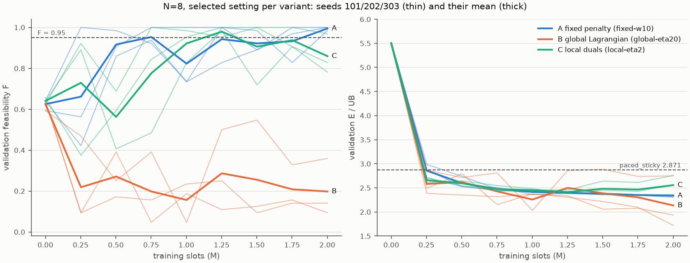

# EXP-DSA05-001 第 1 阶段：N=8 短训的调参、补种子与长训判定

按 [EXP-DSA05-001](../../experiment-designs/001-constrained-mappo_20260924.md) §9 预先写定的规则，在 N=8 上对三种约束处理方式各做短训（每次 200 万时隙）：先在种子 101 上调参（1a），再给每个变体的入选设置补跑种子 202 和 303（1b），最后按判据决定哪些变体进入长训。所有判断只用验证集，**本阶段没有评估测试集**。

## 结论

| 变体 | 入选设置 | 3 个种子选中候选的 F 均值 | 能耗/上界均值 | 判定 |
|---|---|---|---|---|
| A 固定惩罚 | w=10 | 0.995 | **2.337** | 通过，进入长训 |
| B 全局拉格朗日 | η_B=20 | 0.625（均为未训练的初始策略） | 5.500 | 未通过 |
| C 逐 UE 局部对偶 | η=2，μ_max=50 | 0.984 | **2.404** | 通过，进入长训 |
| 最强本地基线 paced_sticky | margin=0.5 | 0.953 | 2.871 | — |

判据：F 均值 ≥ 0.95，且能耗/上界均值 < 2.871。

1. **A 与 C 都满足约束，能耗/上界比最强本地基线低 16–19%**（2.337 和 2.404，对比 2.871）。这是验证集上的结果，经过了选模，存在选择偏差，最终结论以测试集为准。
2. **没有证据表明 C 优于 A。** A 的能耗/上界均值略低，各种子都在最后一个检查点被选中，比较稳定。C 有 2 个种子选中的是训练中途（125 万时隙）的检查点，且最后检查点的 F 回落到 0.78–0.83。3 个种子的差距（0.067）没有做配对检验，只作描述。
3. **B 的失败有明确的机制**：全局乘子由全网按包计数的违约率驱动。周期短的 UE 包多，决定了这个平均值；周期长、距离远的 UE 被放弃，对平均值影响很小（§4）。
4. **A 和 C 都偏保守**：最后检查点的逐 UE 违约率均值只有 0.2–1.1%，远低于允许的 5%，约束允许的节能余量还没有用上。

## 1. 设置与来源

| 项目 | 内容 |
|---|---|
| 场景 | `configs/scenario-v1-n8.toml`（冻结 v1.0，N=8，K=4） |
| 训练配置 | `configs/exp001-constrained-mappo.toml`，各设置对应其中的 profile |
| 训练 | 每次 200 万时隙（977 次迭代 × 2048），每个回合从训练池新抽一个实例，回合长 600 时隙 |
| 验证 | 每约 25 万时隙一次，使用协议 v1 的验证集（64 个实例 × 1 次执行）；变体 C 每次验证评估 μ0 ∈ {0, 5, 25} |
| 1a | 8 个设置（种子 101），提交 `73d7305` |
| 1b | 6 个运行（3 个入选设置 × 种子 202、303），提交 `7fbf36b`；两次提交之间 `src/` 与 `configs/` 完全相同 |
| 运行 | 全部 `--formal`，启动时工作区干净；A、B 每次约 40–43 分钟，C 每次约 52–54 分钟（单线程） |
| 原始输出 | `outputs/exp001-stage1a/`、`outputs/exp001-stage1b/`（Git 忽略；含检查点、逐迭代训练日志和逐回合验证结果） |
| 汇总 | [summary.json](summary.json)，由 [`scripts/analyze_exp001_stage1.py`](../../../scripts/analyze_exp001_stage1.py) 生成，记录了每个运行 `result.json` 的 SHA-256 |

调参规模为 4 + 2 + 2×3 = 12 种配置，第 1b 步没有再调参。

## 2. 第 1a 步：调参（种子 101）

各设置按协议规则在本运行内选出的候选：

| 变体 | 设置 | 选中的候选 | F | 能耗/上界 | 最差 UE 完成率 | mW/UE |
|---|---|---|---|---|---|---|
| A | w=1 | 初始策略 | 0.641 | 5.475 | 0.957 | 22.21 |
| A | w=3 | 初始策略 | 0.641 | 5.475 | 0.957 | 22.21 |
| A | **w=10** | 最后检查点 | 1.000 | **2.305** | 0.989 | 10.03 |
| A | w=30 | 150 万时隙 | 0.984 | 2.330 | 0.989 | 10.12 |
| B | η_B=5 | 初始策略 | 0.641 | 5.475 | 0.957 | 22.21 |
| B | **η_B=20** | 初始策略 | 0.641 | 5.475 | 0.957 | 22.21 |
| C | **η=2** | 125 万时隙，μ0=5 | 1.000 | **2.404** | 0.992 | 10.39 |
| C | η=5 | 125 万时隙，μ0=25 | 0.953 | 2.423 | 0.977 | 10.50 |

加粗为入选设置。

- **w=1 与 w=3**：惩罚太小，训练后的检查点都不可行。w=1 时策略直接放弃大量的包，100 万时隙之后能耗/上界为 0.52–0.79，最差 UE 的完成率为 0。规则因此选中了初始策略。
- **B 的入选设置带有随意性**：两个设置训练出的检查点都不可行，规则退而选可行率最高的候选，结果两者都是同一个初始策略（种子相同），只能按名称决定。所以选中 η_B=20 并不说明它优于 η_B=5。



## 3. 第 1b 步：补种子

| 变体 | 种子 | 选中的候选 | F | 能耗/上界 | 最差 UE 完成率 | 最后检查点的 F / 能耗/上界 |
|---|---|---|---|---|---|---|
| A | 101 | 最后检查点 | 1.000 | 2.305 | 0.989 | 同左 |
| A | 202 | 最后检查点 | 0.984 | 2.346 | 0.988 | 同左 |
| A | 303 | 最后检查点 | 1.000 | 2.360 | 0.989 | 同左 |
| C | 101 | 125 万时隙，μ0=5 | 1.000 | 2.404 | 0.992 | 0.781 / 2.561 |
| C | 202 | 125 万时隙，μ0=0 | 0.984 | 2.456 | 0.990 | 0.828 / 2.758 |
| C | 303 | 最后检查点，μ0=25 | 0.969 | 2.351 | 0.987 | 同左 |
| B | 101 / 202 / 303 | 初始策略 | 0.641 / 0.641 / 0.594 | 5.475 / 5.520 / 5.504 | — | 0.094 / 0.141 / 0.359（F） |

- **A**：3 个种子的最后检查点都可行（F 为 1.000、0.984、1.000），能耗/上界在 100 万时隙之后稳定在 2.31–2.46。可行率在训练后半段仍有波动：种子 101 在 100–150 万时隙时 F 为 0.73–0.89，种子 202 在 175 万时隙时为 0.83。
- **C**：3 个种子选中的 μ0 各不相同（5、0、25），后期可行率的波动也比 A 大（见下图）。
- **B**：训练后的能耗/上界能降到 1.7–2.7，但几乎没有回合可行。



## 4. B 为什么失败：按包平均的违约率掩盖了被放弃的 UE

对最后检查点的验证回合，按 UE 统计违约率（每个 UE 的窗口内有 1800/P 个包；远端指到 AP 距离 ≥ 75 m）：

| 运行 | 逐 UE 平均违约率 | 按包加权违约率 | 远端 / 近端平均 | P=40 远端 UE 的平均违约率 | 完全放弃的 UE 回合（P=40 / P=20） |
|---|---|---|---|---|---|
| A 种子 101 | 0.0016 | 0.0012 | 0.0031 / 0.0006 | 0.008 | 0 / 0 |
| C 种子 101 | 0.0110 | 0.0085 | 0.0159 / 0.0075 | 0.037 | 0 / 0 |
| B 种子 101 | 0.1389 | 0.0890 | 0.3325 / 0.0010 | 0.738 | 27 / 7 |
| B 种子 202 | 0.0956 | **0.0478** | 0.2278 / 0.0015 | 0.775 | 30 / 2 |
| B 种子 303 | 0.0251 | 0.0297 | 0.0599 / 0.0002 | 0.036 | 0 / 0 |

"完全放弃"指该 UE 在整个评价窗口内的违约率为 1，即没有一个包按期交付。

- B 的全局乘子按训练批次中**按包计数**的违约率更新。P=10 的 UE 的包数是 P=40 的 4 倍，决定了这个平均值。B 种子 202 的按包加权违约率为 0.048，低于 ε=0.05，乘子没有理由上升；但按 UE 平均是 0.096，有 30 个 P=40 的 UE 回合完全没有交付。
- 训练日志显示，B 的乘子在 977 次迭代中有 12.7%（η_B=5）到 22–24%（η_B=20 的 3 个种子）的迭代处于 0，分别有 12–30 次从正值降回 0；乘子均值只有 2.7–5.5（固定惩罚 A 的权重为 10）。策略因此越来越省电，最差 UE 的完成率一路下降。
- B 种子 303 没有放弃任何 UE，但许多回合里仍有 UE 略超 5%，F 只有 0.36。所以"放弃长周期远端 UE"是 3 个种子中 2 个的失败方式，不是全部。
- 这印证了设计时的判断：约束是逐 UE 的，乘子也必须逐 UE。A 用统一的固定权重，C 用逐 UE 的乘子，两者都没有出现放弃 UE 的情况。

## 5. 讨论与边界

- **只用了验证集**：选模和判定都用的是验证集，结果带有选择偏差，结论以测试集为准。
- **种子少**：每个变体只有 3 个种子；A 与 C 之间的差距没有做统计检验。
- **C 的 μ0 不稳定**：3 个种子选中的 μ0 各不相同，说明 μ0 对结果有影响而且依赖种子。这与 [FSAL-DVR-2025](../../../papers/FSAL-DVR-2025/analysis.md) 指出的"执行初期暂态"问题一致；按 UE 回归 μ0 是一个候选改进（见[文献笔记](../../research/literature-variant-c_20260925.md)）。
- **偏保守**：A 与 C 的逐 UE 违约率都远低于 5%。允许 5% 违约时，中央最优只能再省约 4.7%（[上下界报告](../central-bounds_20260924/report.md)），所以这部分余量对能耗的影响不大；但它说明两种方法都没有精确地把违约率贴近约束上限。
- **没有测试 N=12**：N=12 在第 0 阶段的诊断训练中还没有学会，是否能学会要在长训中检验。

## 6. 下一步（待确认）

按判据，A 和 C 进入第 2 阶段：在 N=8 和 N=12 上长训（每个种子 2000 万时隙）。长训的具体参数，例如验证间隔、C 的 μ0 候选、N=12 的训练设置，设计文档中还没有规定，需要另写第 2 阶段的执行细则。结合文献检索的发现（变体 C 的机制本身不新，而且本阶段也没有显示出优于 A），是否先调整方法再长训，需要先确定研究方向。

## 7. 复现

```bash
# 1a：在提交 73d7305 上
for spec in fixed:fixed-w1 fixed:fixed-w3 fixed:fixed-w10 fixed:fixed-w30 \
            global:global-eta5 global:global-eta20 local:local-eta2 local:local-eta5; do
  uv run --locked python -m dsa_period.experiments.train_constrained_mappo \
    --scenario configs/scenario-v1-n8.toml --variant ${spec%%:*} --profile ${spec##*:} \
    --seed 101 --output outputs/exp001-stage1a/n8-${spec##*:}-seed101 --formal
done
# 1b：在提交 7fbf36b 上
for spec in fixed:fixed-w10 global:global-eta20 local:local-eta2; do for seed in 202 303; do
  uv run --locked python -m dsa_period.experiments.train_constrained_mappo \
    --scenario configs/scenario-v1-n8.toml --variant ${spec%%:*} --profile ${spec##*:} \
    --seed $seed --output outputs/exp001-stage1b/n8-${spec##*:}-seed$seed --formal
done; done
# 分析：在本报告所在的提交上
uv run --locked python scripts/analyze_exp001_stage1.py \
  $(ls -d outputs/exp001-stage1a/n8-*-seed101/ outputs/exp001-stage1b/n8-*-seed*/) \
  --output <路径>/summary.json --figure <路径>/selected-settings.png --tuning-figure <路径>/tuning.png
```

训练在 CPU 单线程下是确定性的，但不同机器的浮点结果可能不同，本报告没有做跨机器的复现核验。
