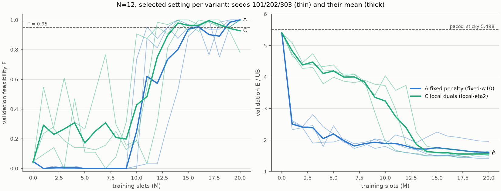

# EXP-DSA05-001 第 2a 阶段：N=12 长训

按 [EXP-DSA05-001](../../experiment-designs/001-constrained-mappo_20260924.md) §10，在 N=12 上对 A（固定惩罚 w=10）和 C（逐 UE 对偶 η=2）各做 3 个种子的长训，每个种子 2000 万时隙，超参数沿用 N=8 的选择。只用验证集。

## 结论

| 变体 | 3 个种子选中候选的 F 均值 | 能耗/上界均值 | 判定 |
|---|---|---|---|
| A 固定惩罚（w=10） | 0.995 | **1.607** | 可行且优于基线 |
| C 逐 UE 对偶（η=2） | 0.984 | **1.514** | 可行且优于基线 |
| 最强本地基线 paced_sticky（margin=8） | 0.984 | 5.498 | — |

1. **两个变体都满足约束，能耗只有最强本地基线的 27.5–29.2%**（1.514 和 1.607 对 5.498）。距离中央正交分时上界还有 51–61%。这是验证集上经过选模的结果，最终以测试集为准。
2. **长训后的策略学会了轮流发送**：占空比 0.44–0.64，与中央上界的 0.55 相当；冲突率 0.30–0.51，干扰损失 0.12–0.25。N=8 短训的这三项分别是 0.83–0.99、0.65–0.74、0.38–0.44（见[能耗损失诊断](../exp001-efficiency-diagnosis_20260925/report.md)）。
3. **F 在熵系数降到 0 之后迅速升高**：3 个种子的 F 均值在前 1000 万时隙里，A 不超过 0.05，C 不超过 0.31；1000 万时隙之后迅速上升，C 在 1400 万时隙达到 0.98，A 在 1500 万时隙达到 0.94。1000 万时隙正是熵系数线性降到 0 的时刻。熵正则带来的动作随机性，是训练前期回合不可行的主要原因。
4. **A 与 C 的最终表现相当，差别在训练过程**：A 的能耗在前 100 万时隙就降到约 2.5，但这时它放弃了远端 UE（300 万时隙时最差 UE 的完成率只有 0.01–0.15），直到熵降到 0 以后才恢复可行。C 在整个训练中都较少牺牲 UE（300 万时隙时最差 UE 完成率为 0.63–0.93），能耗下降得慢，最终与 A 相当。3 个种子的差距（1.514 对 1.607）主要来自 A 种子 303（1.953），没有做统计检验，只作描述。
5. **更正第 2a 阶段的中期判断**：训练到 300–400 万时隙时，我曾据 A 放弃远端 UE 推测"固定惩罚在 N=12 上失效、逐 UE 对偶的价值在于鲁棒性"。长训结束时 A 已经恢复可行，这个推测不成立。

## 1. 设置与来源

| 项目 | 内容 |
|---|---|
| 场景 | `configs/scenario-v1-n12.toml`（冻结 v1.0，N=12，K=4） |
| 配置 | [exp001-constrained-mappo-long.toml](../../../configs/exp001-constrained-mappo-long.toml)：每个种子 2000 万时隙，熵系数在前 1000 万时隙降到 0，每 100 万时隙验证一次（64 个验证实例；C 每次评估 μ0 ∈ {0, 5, 25}） |
| 运行 | A、C 各种子 101、202、303，`--formal`，提交 `110e1f0`，工作区干净；每个运行 7.9–8.6 小时（单线程，6 个并行） |
| 原始输出 | `outputs/exp001-phase2a/`（Git 忽略） |
| 汇总 | [summary.json](summary.json)，由 [`scripts/analyze_exp001_stage1.py`](../../../scripts/analyze_exp001_stage1.py) 生成 |
| 诊断 | [diagnosis.json](diagnosis.json)，由 [`scripts/diagnose_exp001_efficiency.py`](../../../scripts/diagnose_exp001_efficiency.py) 生成，提交 `847f4c7`，工作区干净，单线程，重放选中的检查点 |

## 2. 各种子的选中候选

| 变体 | 种子 | 选中的候选 | F | 能耗/上界 | 最后检查点的 F / 能耗/上界 |
|---|---|---|---|---|---|
| A | 101 | 1800 万时隙 | 0.984 | 1.452 | 1.000 / 1.454 |
| A | 202 | 最后检查点 | 1.000 | 1.416 | 同左 |
| A | 303 | 最后检查点 | 1.000 | 1.953 | 同左 |
| C | 101 | 1900 万时隙，μ0=25 | 0.953 | 1.577 | 1.000 / 1.645 |
| C | 202 | 1700 万时隙，μ0=5 | 1.000 | 1.460 | 0.781 / 1.528 |
| C | 303 | 最后检查点，μ0=25 | 1.000 | 1.506 | 同左 |

最后检查点的逐 UE 违约率均值只有 0.03–0.54%，没有任何 UE 被完全放弃。



## 3. 行为诊断（64 个验证实例，重放选中的检查点）

| 策略 | 能耗/下界 | 占空比 | 冲突率 | 干扰损失 | 功率档占比（5/10/15/19/23 dBm） |
|---|---|---|---|---|---|
| A 种子 101 | 2.107 | 0.498 | 0.354 | 0.136 | 0.16 / 0.40 / 0.35 / 0.09 / 0.00 |
| A 种子 202 | 2.059 | 0.534 | 0.331 | 0.115 | 0.26 / 0.31 / 0.34 / 0.10 / 0.00 |
| A 种子 303 | 2.803 | 0.539 | 0.509 | 0.249 | 0.24 / 0.22 / 0.38 / 0.15 / 0.01 |
| C 种子 101 | 2.277 | 0.440 | 0.300 | 0.148 | 0.20 / 0.23 / 0.45 / 0.11 / 0.00 |
| C 种子 202 | 2.112 | 0.589 | 0.385 | 0.135 | 0.27 / 0.27 / 0.37 / 0.08 / 0.00 |
| C 种子 303 | 2.185 | 0.643 | 0.421 | 0.148 | 0.24 / 0.34 / 0.31 / 0.10 / 0.00 |
| paced_sticky（margin=8） | 7.682 | 1.000 | 0.440 | 0.348 | 0.18 / 0.11 / 0.13 / 0.11 / 0.47 |
| 中央上界调度 | 1.453 | 0.552 | 0.000 | 0.000 | 0.11 / 0.53 / 0.36 / 0.00 / 0.00 |

- 学到的策略的占空比与中央上界相当，说明它们学会了"有包时并不总发"，在时间上错开。
- 仍有 30–51% 的发送与他人共用子信道，干扰损失 12–25%。这是剩余差距的主要来源。
- A 种子 303 的冲突率和干扰损失明显高于其他种子，能耗也最高，说明结果对训练种子仍然敏感。
- 学到的策略用 15 dBm 和 19 dBm 的比例高于中央上界，可能是在补偿剩余的冲突。

## 4. 对后续研究的影响

- **N=8 短训的冲突问题主要是训练不足**：在同样的方法下，N=12 长训学会了错开发送。N=8 短训只有 200 万时隙，熵在 100 万时隙就降到 0，可能还没来得及学会协调。EXP-DSA05-002 和草案 EXP-DSA05-003 的立论都建立在 N=8 短训的诊断上，需要重新审视。
- **N=8 长训是必要的对照**：要确认"训练不足"这一解释，也为了论文给出 N=8 的正式结果，应当按原计划做 N=8 长训。
- **熵调度的作用**：F 的突变与熵降到 0 同时发生。论文的训练配方中需要说明这一点，也可以作为消融。

## 5. 边界

- 只用验证集，结果带有选模偏差，最终以测试集为准。
- 每个变体只有 3 个种子；A 种子 303 明显偏离其他种子。
- 超参数沿用 N=8 的选择，没有在 N=12 上重新调参。
- 训练预算和熵调度同时改变（与短训相比），无法把改进单独归因于其中一个。

## 6. 复现

```bash
# 训练：在提交 110e1f0 上
for spec in fixed:fixed-w10 local:local-eta2; do for seed in 101 202 303; do
  uv run --locked python -m dsa_period.experiments.train_constrained_mappo \
    --config configs/exp001-constrained-mappo-long.toml --scenario configs/scenario-v1-n12.toml \
    --variant ${spec%%:*} --profile ${spec##*:} --seed $seed \
    --output outputs/exp001-phase2a/n12-${spec##*:}-seed$seed --formal
done; done
# 汇总与图：在本报告所在的提交上
uv run --locked python scripts/analyze_exp001_stage1.py $(ls -d outputs/exp001-phase2a/n12-*/) \
  --output <路径>/summary.json --figure <路径>/selected-settings.png
# 诊断：在提交 847f4c7 上（检查点为各运行选中的候选）
OMP_NUM_THREADS=1 uv run --locked python scripts/diagnose_exp001_efficiency.py \
  --scenario configs/scenario-v1-n12.toml --instances 64 \
  --checkpoint A-s101=outputs/exp001-phase2a/n12-fixed-w10-seed101/checkpoints/step-018001920.pt \
  --checkpoint A-s202=outputs/exp001-phase2a/n12-fixed-w10-seed202/checkpoints/step-020000768.pt \
  --checkpoint A-s303=outputs/exp001-phase2a/n12-fixed-w10-seed303/checkpoints/step-020000768.pt \
  --checkpoint C-s101=outputs/exp001-phase2a/n12-local-eta2-seed101/checkpoints/step-019001344.pt@25 \
  --checkpoint C-s202=outputs/exp001-phase2a/n12-local-eta2-seed202/checkpoints/step-017000448.pt@5 \
  --checkpoint C-s303=outputs/exp001-phase2a/n12-local-eta2-seed303/checkpoints/step-020000768.pt@25 \
  --baseline paced_sticky:margin=8 --output <路径>/diagnosis.json
```
