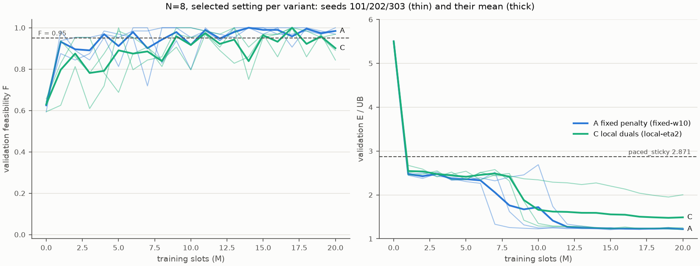

# EXP-DSA05-001 第 2b 阶段：N=8 长训

按 [EXP-DSA05-001](../../experiment-designs/001-constrained-mappo_20260924.md) §11，在 N=8 上对 A（固定惩罚 w=10）和 C（逐 UE 对偶 η=2）各做 3 个种子的长训，每个种子 2000 万时隙，配置与 [N=12 长训](../exp001-phase2a_20260925/report.md)相同。只用验证集。

## 结论

| 变体 | 3 个种子选中候选的 F 均值 | 能耗/上界均值 | 第 1 阶段短训（对照） | 判定 |
|---|---|---|---|---|
| A 固定惩罚（w=10） | 1.000 | **1.213** | 0.995 / 2.337 | 可行且优于基线 |
| C 逐 UE 对偶（η=2） | 0.979 | **1.464** | 0.984 / 2.404 | 可行且优于基线 |
| 最强本地基线 paced_sticky（margin=0.5） | 0.953 | 2.871 | — | — |

1. **N=8 短训的差距主要来自训练不足。** 同样的方法、同样的超参数，长训后能耗/上界从 2.3–2.4 降到 1.21（A）；冲突率从 0.65–0.74 降到 0.19–0.26，干扰损失从 0.38–0.44 降到 0.06–0.07。长训在 200 万时隙时（相当于短训的预算），3 个种子的能耗/上界均值 A 为 2.43、C 为 2.53，与短训的最终值相当；大幅下降发生在 600–1200 万时隙之间，这时熵系数正在趋近于 0。短训与长训的预算和熵调度同时不同，不能把改进单独归因于其中一项。
2. **A 的 3 个种子高度一致**（1.206–1.222），距离中央正交分时上界只差约 21%；能耗约为逐 UE 单独最优下界的 1.37–1.39 倍，中央上界则为 1.14 倍。
3. **C 有一个种子停在了局部解上**：种子 202、303 与 A 相当（1.210、1.231），种子 101 停在 1.951（冲突率 0.556，干扰损失 0.271）。C 的均值因此高于 A，这不能说明 C 系统性地较差，但说明 C 的训练结果对种子更敏感。
4. **两者都偏保守**：最后检查点的逐 UE 违约率均值只有 0.08–0.8%，远低于允许的 5%，也没有任何 UE 被完全放弃。

## 1. 设置与来源

| 项目 | 内容 |
|---|---|
| 场景 | `configs/scenario-v1-n8.toml`（冻结 v1.0，N=8，K=4） |
| 配置 | [exp001-constrained-mappo-long.toml](../../../configs/exp001-constrained-mappo-long.toml)（与第 2a 阶段相同） |
| 运行 | A、C 各种子 101、202、303，`--formal`，提交 `b83d0a4`，工作区干净；每个运行 6.0–6.5 小时 |
| 代码与第 2a 阶段的差别 | 第 2a 阶段在 `110e1f0` 上运行，之后加入了 EXP-DSA05-002 的周期记忆。该功能默认关闭；测试保证关闭时的特征与原来逐位相同，两组长训的方法一致 |
| 原始输出 | `outputs/exp001-phase2b/`（Git 忽略） |
| 汇总 | [summary.json](summary.json)，由 [`scripts/analyze_exp001_stage1.py`](../../../scripts/analyze_exp001_stage1.py) 生成 |
| 诊断 | [diagnosis.json](diagnosis.json)，由 [`scripts/diagnose_exp001_efficiency.py`](../../../scripts/diagnose_exp001_efficiency.py) 生成，提交 `b83d0a4`，工作区干净，单线程 |

## 2. 各种子的选中候选

| 变体 | 种子 | 选中的候选 | F | 能耗/上界 | 最后检查点的 F / 能耗/上界 |
|---|---|---|---|---|---|
| A | 101 | 1700 万时隙 | 1.000 | 1.211 | 0.969 / 1.223 |
| A | 202 | 1500 万时隙 | 1.000 | 1.206 | 0.984 / 1.213 |
| A | 303 | 1800 万时隙 | 1.000 | 1.222 | 1.000 / 1.225 |
| C | 101 | 1900 万时隙，μ0=5 | 0.969 | 1.951 | 0.844 / 2.002 |
| C | 202 | 最后检查点，μ0=5 | 0.969 | 1.210 | 同左 |
| C | 303 | 1700 万时隙，μ0=5 | 1.000 | 1.231 | 0.891 / 1.251 |



## 3. 行为诊断（64 个验证实例，重放选中的检查点）

| 策略 | 能耗/下界 | 占空比 | 冲突率 | 干扰损失 | 功率档占比（5/10/15/19/23 dBm） |
|---|---|---|---|---|---|
| A 种子 101 | 1.375 | 0.610 | 0.206 | 0.064 | 0.40 / 0.44 / 0.16 / 0.00 / 0.00 |
| A 种子 202 | 1.369 | 0.760 | 0.239 | 0.072 | 0.40 / 0.45 / 0.15 / 0.00 / 0.00 |
| A 种子 303 | 1.386 | 0.680 | 0.188 | 0.056 | 0.38 / 0.44 / 0.18 / 0.00 / 0.00 |
| C 种子 101 | 2.206 | 0.667 | 0.556 | 0.271 | 0.16 / 0.55 / 0.26 / 0.02 / 0.00 |
| C 种子 202 | 1.375 | 0.662 | 0.237 | 0.069 | 0.40 / 0.46 / 0.14 / 0.00 / 0.00 |
| C 种子 303 | 1.400 | 0.727 | 0.259 | 0.070 | 0.44 / 0.40 / 0.16 / 0.00 / 0.00 |
| paced_sticky（margin=0.5） | 3.192 | 1.000 | 0.594 | 0.367 | 0.44 / 0.30 / 0.18 / 0.05 / 0.03 |
| 中央上界调度 | 1.139 | 0.687 | 0.000 | 0.000 | 0.32 / 0.64 / 0.04 / 0.00 / 0.00 |

按距离的能耗与单独最优之比（中位数）：学到的策略（除 C 种子 101）在 0–50 m 为 1.07–1.12，50–75 m 为 1.42–1.45，75–100 m 为 1.36–1.39；中央上界分别为 1.00、1.33、1.08。

- 长训后的策略与中央上界的行为相近：占空比 0.61–0.76（中央上界 0.69），功率主要用 5/10 dBm。
- 剩余差距主要在远端 UE（75–100 m 时 1.36–1.39 对 1.08），以及仍有约 20% 的发送与他人共用子信道。

## 4. 对后续研究的影响

- **EXP-DSA05-003 的立论不再成立**：N=8 和 N=12 的长训都表明，标准 MAPPO 在足够的预算和熵退火下会学会让路。反事实信用如果还有价值，只可能体现在：
  1. 更快地学会协调，即样本效率。短训在 200 万时隙时仍在 2.4 附近，大幅下降出现在 600–1200 万时隙；
  2. 缩小 N=12 剩余的较大差距（能耗/上界 1.5–1.6，冲突率 0.30–0.51）；
  3. 减少像 C 种子 101 这样陷入局部解的情况。

  EXP-DSA05-003 定稿前需要按上述目标修改设计。
- **A 在 N=8 和 N=12 上都稳定且表现好**，C 并没有表现出更好的最终性能。论文中两者的定位需要重新考虑。

## 5. 边界

- 只用验证集，结果带有选模偏差，最终以测试集为准。
- 每个变体只有 3 个种子。
- 超参数（w=10，η=2）是在 N=8 短训上选的，没有针对长训重新调参。

## 6. 复现

```bash
# 训练：在提交 b83d0a4 上
for spec in fixed:fixed-w10 local:local-eta2; do for seed in 101 202 303; do
  uv run --locked python -m dsa_period.experiments.train_constrained_mappo \
    --config configs/exp001-constrained-mappo-long.toml --scenario configs/scenario-v1-n8.toml \
    --variant ${spec%%:*} --profile ${spec##*:} --seed $seed \
    --output outputs/exp001-phase2b/n8-${spec##*:}-seed$seed --formal
done; done
# 诊断：在提交 b83d0a4 上
OMP_NUM_THREADS=1 uv run --locked python scripts/diagnose_exp001_efficiency.py \
  --scenario configs/scenario-v1-n8.toml --instances 64 \
  --checkpoint A-s101=outputs/exp001-phase2b/n8-fixed-w10-seed101/checkpoints/step-017000448.pt \
  --checkpoint A-s202=outputs/exp001-phase2b/n8-fixed-w10-seed202/checkpoints/step-015001600.pt \
  --checkpoint A-s303=outputs/exp001-phase2b/n8-fixed-w10-seed303/checkpoints/step-018001920.pt \
  --checkpoint C-s101=outputs/exp001-phase2b/n8-local-eta2-seed101/checkpoints/step-019001344.pt@5 \
  --checkpoint C-s202=outputs/exp001-phase2b/n8-local-eta2-seed202/checkpoints/step-020000768.pt@5 \
  --checkpoint C-s303=outputs/exp001-phase2b/n8-local-eta2-seed303/checkpoints/step-017000448.pt@5 \
  --baseline paced_sticky:margin=0.5 --output <路径>/diagnosis.json
# 汇总与图：在本报告所在的提交上
uv run --locked python scripts/analyze_exp001_stage1.py $(ls -d outputs/exp001-phase2b/n8-*/) \
  --output <路径>/summary.json --figure <路径>/selected-settings.png
```
