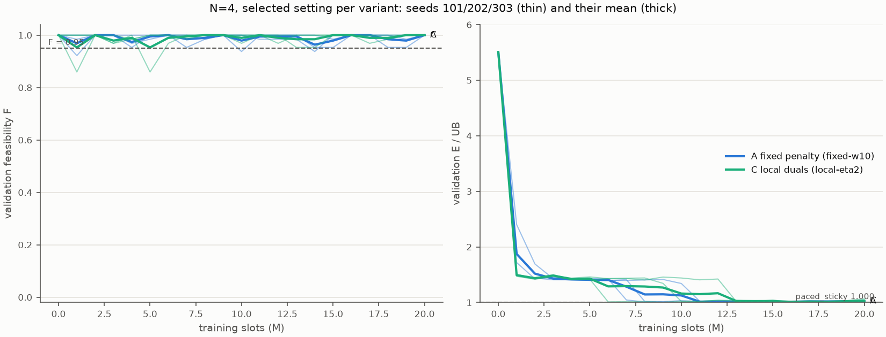
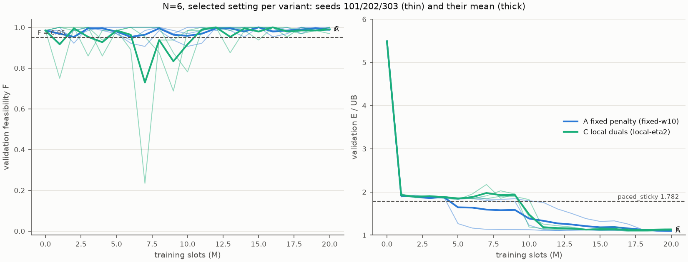

# EXP-DSA05-001 第 2c 阶段：N=4 与 N=6 长训（规模实验）

按 [EXP-DSA05-001](../../experiment-designs/001-constrained-mappo_20260924.md) §12，在 N=4 和 N=6 上对 A（固定惩罚 w=10）和 C（逐 UE 对偶 η=2）各做 3 个种子的长训，配置与 [N=12](../exp001-phase2a_20260925/report.md)、[N=8](../exp001-phase2b_20260925/report.md) 长训完全相同。只用验证集。至此 N ∈ {4, 6, 8, 12} 的长训全部完成。

## 结论

| N | 变体 | 3 个种子选中候选的 F 均值 | 能耗/上界均值 | 最强本地基线 | 判定（§12） |
|---|---|---|---|---|---|
| 4 | A 固定惩罚（w=10） | 0.995 | **1.005** | 1.000（paced_sticky margin=0，已是精确最优） | 可行，距精确最优 0.5% |
| 4 | C 逐 UE 对偶（η=2） | 1.000 | **1.007** | 同上 | 可行，距精确最优 0.7% |
| 6 | A 固定惩罚（w=10） | 0.984 | **1.096** | 1.782（paced_sticky margin=0.25） | 可行且优于基线 |
| 6 | C 逐 UE 对偶（η=2） | 0.995 | **1.108** | 同上 | 可行且优于基线 |

1. **N=4：两个变体都可行，逐种子选中候选的能耗/上界为 1.002–1.010。** N=4 时上界等于精确最优，所以这就是与最优的差距。诊断显示学到的策略几乎没有冲突（冲突率 0–0.003），每个 UE 的能耗都等于它单独占用一个子信道时的最优值。`analyze_exp001_stage1.py` 对 N=4 输出 `passes=False`，这是因为脚本套用了"低于基线"一条，而 N=4 的基线已经是精确最优；按 §12 的预先规定，N=4 只判读可行性，不算失败。
2. **N=6：两个变体都可行，能耗只有最强本地基线的 61.5%（A）和 62.2%（C）**，距中央上界 10–11%。3 个种子一致：A 为 1.086–1.104，C 为 1.086–1.122。没有种子陷入 N=8 上 C 种子 101 那样的局部解。
3. **即使在 N=4，学习也很慢。** 训练到 200 万时隙（短训的预算）时，能耗/上界的 3 个种子均值在 N=4 为 A 1.52、C 1.43，在 N=6 为 A 1.89、C 1.89，N=6 时仍高于基线的 1.782。N=6 的 6 个运行首次"可行且低于基线"的时刻为 500 万–1200 万时隙，其中 5 个在 800 万–1200 万时隙，与熵系数在 1000 万时隙降到 0 的时刻相近。N=4 时一个简单的本地规则就能达到最优，MAPPO 却需要 600 万–1300 万时隙才能把能耗/上界降到 1.2 以下。
4. **与 N=8、N=12 一样偏保守。** 最后检查点的逐 UE 违约率均值只有 0–0.12%，远低于允许的 5%，也没有任何 UE 被放弃。

### 四个 N 的汇总（验证集，选中候选，3 个种子的均值）

| N | 基线能耗/上界 | A 能耗/上界 | C 能耗/上界 | A、C 能耗占基线的比例 | 中央上界/下界 | 学到策略的冲突率 | 报告 |
|---|---|---|---|---|---|---|---|
| 4 | 1.000 | 1.005 | 1.007 | —（基线已最优） | 1.000 | 0–0.003 | 本报告 |
| 6 | 1.782 | 1.096 | 1.108 | 61.5% / 62.2% | 1.027 | 0.055–0.106 | 本报告 |
| 8 | 2.871 | 1.213 | 1.464 | 42.2% / 51.0% | 1.139 | 0.19–0.26（C 种子 101 为 0.556） | [第 2b 阶段](../exp001-phase2b_20260925/report.md) |
| 12 | 5.498 | 1.607 | 1.514 | 29.2% / 27.5% | 1.453 | 0.30–0.51 | [第 2a 阶段](../exp001-phase2a_20260925/report.md) |

"中央上界/下界"是诊断中中央正交分时上界调度的能耗/下界（64 个验证实例），衡量上下界之间的缝隙。负载越高，学到的策略与上界的差距越大（A 为 0.5%、10%、21%、61%，C 为 0.7%、11%、46%、51%），但相对基线的节能也越大；冲突率随 N 单调上升。A 与 C 在 N=4、N=6 上几乎相同；在 N=8 上 C 的均值被一个陷入局部解的种子拉高；在 N=12 上 C 的均值较低，主要因为 A 种子 303 较差。这些都是验证集上经过选模的结果，没有做统计检验，最终以测试集为准。

## 1. 设置与来源

| 项目 | 内容 |
|---|---|
| 场景 | `configs/scenario-v1-n4.toml`、`configs/scenario-v1-n6.toml`（冻结 v1.0，K=4） |
| 配置 | [exp001-constrained-mappo-long.toml](../../../configs/exp001-constrained-mappo-long.toml)（与第 2a、2b 阶段相同）：每个种子 2000 万时隙，熵系数在前 1000 万时隙线性降到 0，每 100 万时隙用 64 个验证实例验证一次；C 每次评估 μ0 ∈ {0, 5, 25} |
| 运行 | A、C 各种子 101、202、303，两个 N 共 12 个运行，`--formal`，提交 `3fa9197`，工作区干净；N=4 每个运行 5.2–6.1 小时，N=6 每个运行 6.0–6.7 小时（单线程，12 个并行） |
| 原始输出 | `outputs/exp001-phase2c/`（Git 忽略） |
| 汇总 | [summary-n4.json](summary-n4.json)、[summary-n6.json](summary-n6.json)，由 [`scripts/analyze_exp001_stage1.py`](../../../scripts/analyze_exp001_stage1.py) 生成 |
| 诊断 | [diagnosis-n4.json](diagnosis-n4.json)、[diagnosis-n6.json](diagnosis-n6.json)，由 [`scripts/diagnose_exp001_efficiency.py`](../../../scripts/diagnose_exp001_efficiency.py) 生成，提交 `e80c5fe`，工作区干净，单线程，重放选中的检查点。`e80c5fe` 与 `3fa9197` 的差别只有新增的测试评估入口、它的测试和文档，训练与环境代码相同 |

## 2. 各种子的选中候选

| N | 变体 | 种子 | 选中的候选 | F | 能耗/上界 | 最后检查点的 F / 能耗/上界 |
|---|---|---|---|---|---|---|
| 4 | A | 101 | 1600 万时隙 | 1.000 | 1.009 | 1.000 / 1.018 |
| 4 | A | 202 | 1100 万时隙 | 1.000 | 1.002 | 1.000 / 1.035 |
| 4 | A | 303 | 1500 万时隙 | 0.984 | 1.006 | 1.000 / 1.019 |
| 4 | C | 101 | 1600 万时隙，μ0=0 | 1.000 | 1.004 | 1.000 / 1.013 |
| 4 | C | 202 | 1600 万时隙，μ0=25 | 1.000 | 1.007 | 1.000 / 1.064 |
| 4 | C | 303 | 1500 万时隙，μ0=25 | 1.000 | 1.010 | 1.000 / 1.015 |
| 6 | A | 101 | 1700 万时隙 | 0.984 | 1.099 | 1.000 / 1.107 |
| 6 | A | 202 | 最后检查点 | 0.984 | 1.104 | 同左 |
| 6 | A | 303 | 最后检查点 | 0.984 | 1.086 | 同左 |
| 6 | C | 101 | 1400 万时隙，μ0=5 | 0.984 | 1.122 | 0.969 / 1.127 |
| 6 | C | 202 | 1800 万时隙，μ0=0 | 1.000 | 1.086 | 1.000 / 1.108 |
| 6 | C | 303 | 1600 万时隙，μ0=5 | 1.000 | 1.115 | 1.000 / 1.153 |

最后检查点的 3 个种子均值：N=4 时 A 为 1.000 / 1.024，C 为 1.000 / 1.031；N=6 时 A 为 0.990 / 1.099，C 为 0.990 / 1.129。





N=6 的多数运行在 100 万时隙到约 1000 万时隙之间停在 1.8–2.2，高于基线，之后才下降。C 的 3 个种子都在 1000 万–1100 万时隙陡降到 1.15–1.45；A 种子 101 在 500 万时隙、种子 202 在 1000 万时隙陡降，种子 303 则从 1100 万到 1800 万时隙逐步下降。

## 3. 行为诊断（64 个验证实例，重放选中的检查点）

### N=4

| 策略 | 能耗/下界 | 占空比 | 冲突率 | 干扰损失 | 功率档占比（5/10/15/19/23 dBm） |
|---|---|---|---|---|---|
| A 种子 101 | 1.008 | 0.728 | 0.000 | 0.000 | 0.67 / 0.33 / 0.00 / 0.00 / 0.00 |
| A 种子 202 | 1.002 | 1.000 | 0.000 | 0.000 | 0.68 / 0.31 / 0.00 / 0.00 / 0.00 |
| A 种子 303 | 1.006 | 0.893 | 0.003 | 0.003 | 0.68 / 0.31 / 0.00 / 0.00 / 0.00 |
| C 种子 101 | 1.004 | 0.720 | 0.000 | 0.000 | 0.68 / 0.32 / 0.00 / 0.00 / 0.00 |
| C 种子 202 | 1.007 | 0.787 | 0.000 | 0.000 | 0.68 / 0.32 / 0.00 / 0.00 / 0.00 |
| C 种子 303 | 1.010 | 0.750 | 0.000 | 0.000 | 0.68 / 0.32 / 0.01 / 0.00 / 0.00 |
| paced_sticky（margin=0） | 1.000 | 1.000 | 0.000 | 0.000 | 0.68 / 0.32 / 0.00 / 0.00 / 0.00 |
| 中央最优调度 | 1.000 | 0.869 | 0.000 | 0.000 | 0.68 / 0.32 / 0.00 / 0.00 / 0.00 |

- 学到的策略给每个 UE 分到了不同的子信道，功率档的构成与最优调度相同；按距离、按周期的能耗与单独最优之比都在 1.00–1.01。
- 占空比从 0.72 到 1.00 不等。N ≤ K 时，同一个包的最优能耗可以用多种时隙安排达到，占空比的差别不影响能耗。

### N=6

| 策略 | 能耗/下界 | 占空比 | 冲突率 | 干扰损失 | 功率档占比（5/10/15/19/23 dBm） |
|---|---|---|---|---|---|
| A 种子 101 | 1.134 | 0.788 | 0.071 | 0.024 | 0.51 / 0.45 / 0.04 / 0.00 / 0.00 |
| A 种子 202 | 1.142 | 0.841 | 0.106 | 0.035 | 0.54 / 0.43 / 0.03 / 0.00 / 0.00 |
| A 种子 303 | 1.122 | 0.720 | 0.055 | 0.017 | 0.56 / 0.40 / 0.04 / 0.00 / 0.00 |
| C 种子 101 | 1.157 | 0.763 | 0.102 | 0.035 | 0.50 / 0.46 / 0.04 / 0.00 / 0.00 |
| C 种子 202 | 1.117 | 0.709 | 0.060 | 0.013 | 0.48 / 0.49 / 0.02 / 0.00 / 0.00 |
| C 种子 303 | 1.152 | 0.819 | 0.077 | 0.026 | 0.52 / 0.43 / 0.05 / 0.00 / 0.00 |
| paced_sticky（margin=0.25） | 1.817 | 1.000 | 0.371 | 0.208 | 0.55 / 0.33 / 0.10 / 0.01 / 0.01 |
| 中央上界调度 | 1.027 | 0.769 | 0.000 | 0.000 | 0.58 / 0.42 / 0.00 / 0.00 / 0.00 |

按距离的能耗与单独最优之比（中位数）：学到的策略在 0–50 m 为 1.00–1.01，50–75 m 为 1.03–1.21，75–100 m 为 1.09–1.15；基线分别为 1.19、1.69、1.84；中央上界都是 1.00。

- 学到的策略冲突率 0.055–0.106，干扰损失 1.3–3.5%，基线分别为 0.371 和 20.8%。
- 剩余差距与 N=8 相同，主要在中远端 UE：近端 UE 已经达到单独最优。学到的策略还有 2–5% 的发送使用 15 dBm，中央上界调度不用 15 dBm，这可能是在补偿剩余的冲突。

## 4. 对后续研究的影响

- **规模实验完整**：N ∈ {4, 6, 8, 12} 的长训模型全部就绪，可以按 [EXP-DSA05-004](../../experiment-designs/004-test-evaluation_20260925.md) 统一评估测试集。
- **N=4 是正确性检验，不是性能卖点**：N ≤ K 时本地规则已经最优，MARL 的价值在 N > K。论文可以把 N=4 写成"学到的策略能恢复已知最优结构"的验证。
- **样本效率是明显的短板**：N=4 也需要 600 万–1300 万时隙，N=6 在 200 万时隙时还不如基线。这支持把 EXP-DSA05-003 的目标（如果继续）改为样本效率，也说明论文需要报告训练曲线和预算。
- **A 与 C 在 N ≤ 8 上没有表现出实质差别**，与第 2a、2b 阶段的结论一致。

## 5. 边界

- 只用验证集，结果带有选模偏差，最终以测试集为准。
- 每个变体只有 3 个种子。
- 超参数（w=10，η=2）是在 N=8 短训上选的，没有在 N=4、N=6 上重新调参。
- N=4 时 64 个验证实例上 F 的分辨率为 1/64，A 种子 303 选中候选的 F=0.984 对应 1 个不可行的实例。

## 6. 复现

```bash
# 训练：在提交 3fa9197 上
for n in 4 6; do for spec in fixed:fixed-w10 local:local-eta2; do for seed in 101 202 303; do
  uv run --locked python -m dsa_period.experiments.train_constrained_mappo \
    --config configs/exp001-constrained-mappo-long.toml --scenario configs/scenario-v1-n$n.toml \
    --variant ${spec%%:*} --profile ${spec##*:} --seed $seed \
    --output outputs/exp001-phase2c/n$n-${spec##*:}-seed$seed --formal
done; done; done
# 汇总与图：在本报告所在的提交上
for n in 4 6; do
  uv run --locked python scripts/analyze_exp001_stage1.py $(ls -d outputs/exp001-phase2c/n$n-*/) \
    --output <路径>/summary-n$n.json --figure <路径>/selected-settings-n$n.png
done
# 诊断：在提交 e80c5fe 上（检查点为各运行选中的候选）
OMP_NUM_THREADS=1 uv run --locked python scripts/diagnose_exp001_efficiency.py \
  --scenario configs/scenario-v1-n4.toml --instances 64 \
  --checkpoint A-s101=outputs/exp001-phase2c/n4-fixed-w10-seed101/checkpoints/step-016001024.pt \
  --checkpoint A-s202=outputs/exp001-phase2c/n4-fixed-w10-seed202/checkpoints/step-011001856.pt \
  --checkpoint A-s303=outputs/exp001-phase2c/n4-fixed-w10-seed303/checkpoints/step-015001600.pt \
  --checkpoint C-s101=outputs/exp001-phase2c/n4-local-eta2-seed101/checkpoints/step-016001024.pt@0 \
  --checkpoint C-s202=outputs/exp001-phase2c/n4-local-eta2-seed202/checkpoints/step-016001024.pt@25 \
  --checkpoint C-s303=outputs/exp001-phase2c/n4-local-eta2-seed303/checkpoints/step-015001600.pt@25 \
  --baseline paced_sticky:margin=0 --output <路径>/diagnosis-n4.json
OMP_NUM_THREADS=1 uv run --locked python scripts/diagnose_exp001_efficiency.py \
  --scenario configs/scenario-v1-n6.toml --instances 64 \
  --checkpoint A-s101=outputs/exp001-phase2c/n6-fixed-w10-seed101/checkpoints/step-017000448.pt \
  --checkpoint A-s202=outputs/exp001-phase2c/n6-fixed-w10-seed202/checkpoints/step-020000768.pt \
  --checkpoint A-s303=outputs/exp001-phase2c/n6-fixed-w10-seed303/checkpoints/step-020000768.pt \
  --checkpoint C-s101=outputs/exp001-phase2c/n6-local-eta2-seed101/checkpoints/step-014000128.pt@5 \
  --checkpoint C-s202=outputs/exp001-phase2c/n6-local-eta2-seed202/checkpoints/step-018001920.pt@0 \
  --checkpoint C-s303=outputs/exp001-phase2c/n6-local-eta2-seed303/checkpoints/step-016001024.pt@5 \
  --baseline paced_sticky:margin=0.25 --output <路径>/diagnosis-n6.json
```
