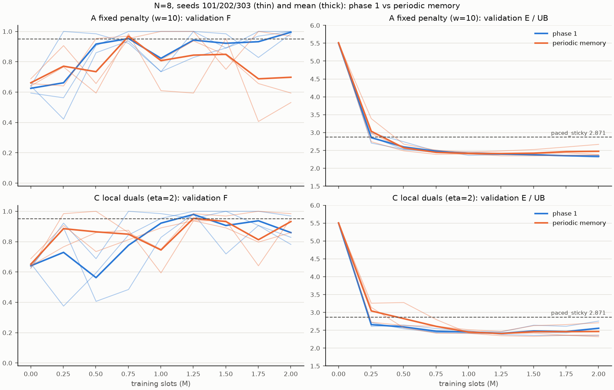

# EXP-DSA05-002：周期记忆（N=8 短训）

按 [EXP-DSA05-002](../../experiment-designs/002-periodic-memory_20260925.md)，在 Actor 的输入中加入按业务周期滞后（10、20、40 个时隙）的逐子信道干扰和自己的发送，与 [EXP-DSA05-001 第 1 阶段](../exp001-phase1_20260925/report.md)同设置、同种子的运行配对比较。只用验证集。

## 结论

**两个变体都不采纳周期记忆。**

| 变体 | F 均值（第 1 阶段 → 周期记忆） | 能耗/上界均值 | 冲突率均值 | 干扰损失均值 | 按规则的类别 |
|---|---|---|---|---|---|
| A 固定惩罚（w=10） | 0.995 → 0.984 | 2.337 → 2.432（**+4.1%**） | 0.712 → 0.670 | 0.418 → 0.392 | 满足 1、3，不满足 2 |
| C 逐 UE 对偶（η=2） | 0.984 → 0.958 | 2.404 → 2.385（−0.8%） | 0.677 → 0.677 | 0.396 → 0.391 | 满足 1、3，不满足 2 |

采纳门槛是三条同时满足：
1. 3 个种子的 F 均值 ≥ 0.95；
2. 能耗/上界相对降低至少 5%；
3. 冲突率均值降低。

两个变体都满足 1 和 3、不满足 2。规则把这一类命名为"机制有效、收益不足"，但这个名字高估了实际情况：
- **C 的冲突率几乎没有变化**（0.6772 → 0.6767）；
- **A 的冲突率下降了 0.04，但能耗反而增加了 4.1%**，而且训练后期的可行率更不稳定：种子 202 和 303 最后检查点的 F 分别只有 0.53 和 0.59，按规则选中的是 75 万时隙处的早期检查点。

总之，周期记忆**没有让 UE 学会错开发送**：占空比仍然在 0.89–1.00，干扰损失仍约 39%，与第 1 阶段没有实质区别。

## 1. 设置与来源

| 项目 | 内容 |
|---|---|
| 配置 | [exp002-periodic-memory.toml](../../../configs/exp002-periodic-memory.toml)：与第 1 阶段短训配置相同，只多了 `periodic_lags = [10, 20, 40]` |
| 运行 | 2 个设置 × 种子 101、202、303，`--formal`，提交 `8c169a0`，工作区干净；每次 51–91 分钟（与 6 个 N=12 长训同时运行） |
| 对照 | 第 1 阶段同设置、同种子的运行（`outputs/exp001-stage1a/`、`outputs/exp001-stage1b/`） |
| 诊断 | [`scripts/diagnose_exp001_efficiency.py`](../../../scripts/diagnose_exp001_efficiency.py)，对选中的检查点在 64 个验证实例上重放，提交 `da5d6b0`，工作区干净，单线程；结果为 [diagnosis.json](diagnosis.json)。对照组的诊断来自[能耗损失诊断](../exp001-efficiency-diagnosis_20260925/report.md) |
| 分析 | [`scripts/analyze_exp002.py`](../../../scripts/analyze_exp002.py)，结果为 [summary.json](summary.json)，其中记录了每个运行 `result.json` 的 SHA-256 |

## 2. 逐种子结果

| 变体 | 种子 | 选中的候选（第 1 阶段 → 周期记忆） | 能耗/上界 | 能耗/上界之差 | 冲突率 |
|---|---|---|---|---|---|
| A | 101 | 最后检查点 → 125 万时隙 | 2.305 → 2.349 | +0.045 | 0.691 → 0.655 |
| A | 202 | 最后检查点 → 75 万时隙 | 2.346 → 2.504 | +0.158 | 0.705 → 0.657 |
| A | 303 | 最后检查点 → 75 万时隙 | 2.360 → 2.441 | +0.082 | 0.740 → 0.698 |
| C | 101 | 125 万时隙 μ0=5 → 125 万时隙 μ0=25 | 2.404 → 2.468 | +0.064 | 0.649 → 0.731 |
| C | 202 | 125 万时隙 μ0=0 → 最后检查点 μ0=5 | 2.456 → 2.367 | −0.089 | 0.662 → 0.662 |
| C | 303 | 最后检查点 μ0=25 → 最后检查点 μ0=25 | 2.351 → 2.320 | −0.031 | 0.720 → 0.638 |

周期记忆组的其他诊断指标：占空比 0.89–1.00，干扰损失 0.37–0.41，最后时隙多发 7–9%。第 1 阶段对应为 0.83–0.99、0.38–0.44、6–9%。



## 3. 为什么没有起作用（推测，没有做干预验证）

1. **先有协调，才有可利用的周期性**：只有其他 UE 的行为大致稳定，一个周期之前的干扰才能预测下一个周期。训练中的策略是随机的（前 100 万时隙熵较高），而且各 UE 都在同时学习，滞后特征能提供的信息有限。这是一个"先有鸡还是先有蛋"的问题。
2. **让出信道的收益属于别人**：要减少冲突，一些 UE 必须在有包时暂时不发。这会增加它自己的能耗或违约风险，好处却落在其他 UE 身上。团队奖励在 N 个 UE 之间平均分摊，这种"为别人让路"的信用很难通过梯度传回给让路的 UE。诊断显示占空比没有下降，与这一推测一致。
3. **N=8、K=4 时，同时发送的 UE 太多**：学到的策略平均约有 7 个 UE 同时发送，分布在 4 个子信道上，冲突不可避免。中央上界的占空比为 0.69，同时发送的约 5.5 个 UE 正好错开，完全不冲突。要做到这一点，需要 UE 之间对"谁在什么时候发"达成一致，只有本地信息而且不通信时，这本身就很难。

## 4. 边界

- 只有 3 个种子，只用了验证集；配对只控制了种子和设置，网络结构变了，训练的随机性也不同。
- 滞后取 {10, 20, 40}，没有尝试其他滞后或其他编码方式（例如按本地时钟对 40 取模的占用表），不能排除其他形式的周期特征有效。
- 预算只有 200 万时隙；更长的训练是否会让周期特征发挥作用，没有检验。

## 5. 复现

```bash
# 训练：在提交 8c169a0 上
for spec in fixed:fixed-w10 local:local-eta2; do for seed in 101 202 303; do
  uv run --locked python -m dsa_period.experiments.train_constrained_mappo \
    --config configs/exp002-periodic-memory.toml --scenario configs/scenario-v1-n8.toml \
    --variant ${spec%%:*} --profile ${spec##*:} --seed $seed \
    --output outputs/exp002/n8-${spec##*:}-seed$seed --formal
done; done
# 诊断：在提交 da5d6b0 上（检查点为各运行 result.json 中选中的候选）
OMP_NUM_THREADS=1 uv run --locked python scripts/diagnose_exp001_efficiency.py --instances 64 \
  --checkpoint A-s101=outputs/exp002/n8-fixed-w10-seed101/checkpoints/step-001251328.pt \
  --checkpoint A-s202=outputs/exp002/n8-fixed-w10-seed202/checkpoints/step-000751616.pt \
  --checkpoint A-s303=outputs/exp002/n8-fixed-w10-seed303/checkpoints/step-000751616.pt \
  --checkpoint C-s101=outputs/exp002/n8-local-eta2-seed101/checkpoints/step-001251328.pt@25 \
  --checkpoint C-s202=outputs/exp002/n8-local-eta2-seed202/checkpoints/step-002000896.pt@5 \
  --checkpoint C-s303=outputs/exp002/n8-local-eta2-seed303/checkpoints/step-002000896.pt@25 \
  --output <路径>/diagnosis.json
# 分析：在本报告所在的提交上
uv run --locked python scripts/analyze_exp002.py \
  --before outputs/exp001-stage1a/n8-{fixed-w10,local-eta2}-seed101 outputs/exp001-stage1b/n8-{fixed-w10,local-eta2}-seed{202,303} \
  --after outputs/exp002/n8-{fixed-w10,local-eta2}-seed{101,202,303} \
  --diagnosis-before docs/results/exp001-efficiency-diagnosis_20260925/summary.json \
  --diagnosis-after <路径>/diagnosis.json --output <路径>/summary.json --figure <路径>/paired-curves.png
```
