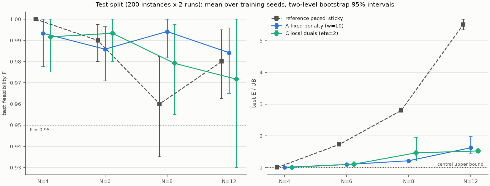

# EXP-DSA05-004：冻结模型的测试集评估

按已定稿的 [EXP-DSA05-004](../../experiment-designs/004-test-evaluation_20260925.md)（2026-09-26 确认），在协议 v1 的测试集上评估 EXP-DSA05-001 的全部冻结模型：
- 四个 N 的长训 A（固定惩罚 w=10）和 C（逐 UE 对偶 η=2），各 3 个种子，选中检查点与最后检查点都评估；
- N=8 短训的 A、B、C；
- 各 N 的本地基线。

测试集为 200 个实例 × 2 次执行，所有方法共用协议冻结的执行种子。区间为两层 bootstrap 的 95% 区间（训练种子 × 实例，10,000 次，种子 20260926）。这是测试集第一次被读取；此后不再根据测试结果修改任何方法、超参数或选模规则。

## 结论（按 §3 预先写定的判读）

| N | 方法（选中检查点） | F [95% 区间] | 能耗/上界 [95% 区间] | 与参照基线的配对差 [95% 区间] | 判读 |
|---|---|---|---|---|---|
| 4 | A | 0.993 [0.978, 1.000] | 1.007 [1.004, 1.010] | +0.007 [+0.004, +0.010] | 满足约束；距精确最优 0.7% |
| 4 | C | 0.992 [0.975, 1.000] | 1.008 [1.004, 1.012] | +0.008 [+0.004, +0.012] | 满足约束；距精确最优 0.8% |
| 4 | 参照 paced_sticky（margin=0） | 1.000 | 1.000 | — | 精确最优 |
| 6 | A | 0.986 [0.971, 0.997] | 1.094 [1.086, 1.103] | −0.631 [−0.659, −0.603] | 满足约束，显著节能 |
| 6 | C | 0.993 [0.980, 1.000] | 1.106 [1.088, 1.122] | −0.619 [−0.651, −0.588] | 满足约束，显著节能 |
| 6 | 参照 paced_sticky（margin=0.25） | 0.990 [0.980, 0.998] | 1.725 [1.697, 1.753] | — | — |
| 8 | A | 0.994 [0.982, 1.000] | 1.213 [1.205, 1.221] | −1.585 [−1.632, −1.541] | 满足约束，显著节能 |
| 8 | C | 0.979 [0.955, 0.998] | 1.463 [1.209, 1.949] | −1.334 [−1.612, −0.861] | 满足约束，显著节能 |
| 8 | 参照 paced_sticky（margin=0.5） | 0.960 [0.935, 0.983] | 2.798 [2.753, 2.845] | — | — |
| 12 | A | 0.984 [0.965, 0.996] | 1.623 [1.428, 1.976] | −3.885 [−4.179, −3.535] | 满足约束，显著节能 |
| 12 | C | 0.972 [0.930, 1.000] | 1.522 [1.476, 1.576] | −3.987 [−4.159, −3.818] | 满足约束，显著节能 |
| 12 | 参照 paced_sticky（margin=8） | 0.980 [0.963, 0.995] | 5.508 [5.343, 5.678] | — | — |

1. **满足约束**：长训 A 与 C 的选中检查点在四个 N 上的 F 都 ≥ 0.95（0.972–0.994）。按规则以均值判读；N=12 的 C 区间下限为 0.930，低于 0.95。各 N 的参照基线也都满足约束（N=8 为 0.960，区间下限 0.935）。
2. **显著节能**：N=6、8、12 上，A 与 C 的选中检查点与参照基线的配对差区间上限都小于 0。以能耗/上界的均值之比计，A、C 的能耗约为参照基线的 63%、64%（N=6），43%、52%（N=8），29%、28%（N=12）。N=4 按规则不判读这一条：参照基线已是精确最优，A、C 比它高 0.7%、0.8%，区间不含 0。
3. **A 与 C 没有显著差异**：四个 N 上，选中检查点能耗/上界之差（A − C）的区间都包含 0：

   | N | A − C | 95% 区间 |
   |---|---|---|
   | 4 | −0.001 | [−0.005, +0.004] |
   | 6 | −0.012 | [−0.028, +0.007] |
   | 8 | −0.251 | [−0.737, +0.005] |
   | 12 | +0.101 | [−0.119, +0.452] |

   N=8 的差距主要来自 C 种子 101（1.952），N=12 的主要来自 A 种子 303（1.983），两者的区间都因此很宽。
4. **与最优的差距**（选中检查点）：

   | N | A 能耗/上界 | C 能耗/上界 | A 能耗/下界 | C 能耗/下界 |
   |---|---|---|---|---|
   | 4 | 1.007 | 1.008 | 1.007 | 1.008 |
   | 6 | 1.094 | 1.106 | 1.119 | 1.131 |
   | 8 | 1.213 | 1.463 | 1.349 | 1.628 |
   | 12 | 1.623 | 1.522 | 2.289 | 2.147 |

   N=4 时上界等于下界（精确最优）。
5. **次要结果（N=8 短训）**：
   - B 的 F 为 0.592 [0.530, 0.654]，小于 0.95，确认了验证集上的失败。但 B 的选中候选是未训练的初始策略（见 §4 的说明），这只说明 B 的选中结果在测试集上仍不可行。
   - 短训的 A、C 都满足约束（0.989、0.988），并且显著优于参照基线：能耗/上界 2.321、2.380，基线 2.798。
   - 长训比短训的能耗/上界低：A 为 −1.109 [−1.136, −1.078]，C 为 −0.917 [−1.194, −0.445]。

### 预先登记之外的观察（描述性）

- **验证集与测试集高度一致**，选模偏差很小。选中检查点的能耗/上界在两个集合上相差 0.000–0.016：

  | N | A（验证 → 测试） | C（验证 → 测试） | 参照基线（验证 → 测试） |
  |---|---|---|---|
  | 4 | 1.005 → 1.007 | 1.007 → 1.008 | 1.000 → 1.000 |
  | 6 | 1.096 → 1.094 | 1.108 → 1.106 | 1.782 → 1.725 |
  | 8 | 1.213 → 1.213 | 1.464 → 1.463 | 2.871 → 2.798 |
  | 12 | 1.607 → 1.623 | 1.514 → 1.522 | 5.498 → 5.508 |
- **C 依赖检查点选择，A 不依赖**：
  - A 的最后检查点在四个 N 上都满足约束（F 0.987–0.992），能耗/上界与选中检查点只差 0.001–0.014；
  - C 的最后检查点在 N=8（F 0.915）和 N=12（0.938）上不满足约束；
  - 在 N=6，最后检查点的 A − C 为 −0.029 [−0.053, −0.009]，区间不含 0，A 较好。

## 1. 设置与来源

| 项目 | 内容 |
|---|---|
| 计划 | [EXP-DSA05-004](../../experiment-designs/004-test-evaluation_20260925.md)，定稿提交 `f03b807` |
| 入口 | `python -m dsa_period.experiments.evaluate_marl --split test --confirm-test --formal`，每个 worker 单线程 |
| 长训评估 | 每个 N 一次调用，提交 `f03b807`，工作区干净；`--checkpoints both`；基线为参照 paced_sticky 与 random_max、sticky_max、lazy_pacing |
| 短训评估 | 一次调用，提交 `8825d03`，工作区干净。它与 `f03b807` 的差别只有新增的汇总脚本 `scripts/summarize_exp004_test.py`。`--checkpoints selected`，基线只有参照 paced_sticky（margin=0.5） |
| 被评估的训练运行 | N=12：第 2a 阶段，训练提交 `110e1f0`；N=8：第 2b 阶段，`b83d0a4`；N=4、N=6：第 2c 阶段，`3fa9197`；N=8 短训：第 1 阶段，`73d7305`（种子 101）、`7fbf36b`（种子 202、303）。每个检查点的 SHA-256 记录在原始输出和 [summary.json](summary.json) 中 |
| 短训检查点的兼容性检查 | 读取测试集之前，在验证集上重放第 1 阶段的 9 个选中候选：F 与能耗/上界都与各运行 `result.json` 中的存档逐位相同 |
| 一致性检查 | N=8 两次调用中，参照基线的 400 个回合结果逐位相同 |
| 原始输出 | `outputs/exp004-test/`（Git 忽略），各文件的 SHA-256 记录在 summary.json 中 |
| 汇总与图 | [summary.json](summary.json)、[test-results.png](test-results.png)，由 [`scripts/summarize_exp004_test.py`](../../../scripts/summarize_exp004_test.py) 在提交 `8825d03` 上生成 |
| 耗时 | 5 次调用并行，共 32 个 worker，每次 14–19 分钟 |



## 2. 完整结果

### 2.1 长训：选中与最后检查点

| N | 方法 | F | 能耗/上界 | 最差 UE 完成率 | 每 UE 功率（mW） | 逐 UE 违约率 95% 分位 / 最大 |
|---|---|---|---|---|---|---|
| 4 | A 选中 | 0.993 | 1.007 | 0.998 | 3.85 | 0.000 / 0.733 |
| 4 | A 最后 | 0.992 | 1.021 | 0.998 | 3.90 | 0.000 / 0.511 |
| 4 | C 选中 | 0.992 | 1.008 | 0.999 | 3.85 | 0.000 / 0.156 |
| 4 | C 最后 | 0.994 | 1.030 | 0.998 | 3.93 | 0.000 / 0.133 |
| 4 | 参照 paced_sticky | 1.000 | 1.000 | 1.000 | 3.82 | 0.000 / 0.000 |
| 6 | A 选中 | 0.986 | 1.094 | 0.995 | 4.36 | 0.006 / 0.200 |
| 6 | A 最后 | 0.991 | 1.096 | 0.996 | 4.37 | 0.006 / 0.200 |
| 6 | C 选中 | 0.993 | 1.106 | 0.996 | 4.40 | 0.000 / 0.356 |
| 6 | C 最后 | 0.997 | 1.125 | 0.997 | 4.48 | 0.000 / 0.200 |
| 6 | 参照 paced_sticky | 0.990 | 1.725 | 0.992 | 6.83 | 0.011 / 0.067 |
| 8 | A 选中 | 0.994 | 1.213 | 0.997 | 5.30 | 0.000 / 0.089 |
| 8 | A 最后 | 0.987 | 1.217 | 0.994 | 5.33 | 0.006 / 0.178 |
| 8 | C 选中 | 0.979 | 1.463 | 0.992 | 6.39 | 0.011 / 0.111 |
| 8 | C 最后 | 0.915 | 1.484 | 0.983 | 6.48 | 0.022 / 0.178 |
| 8 | 参照 paced_sticky | 0.960 | 2.798 | 0.978 | 12.07 | 0.028 / 0.106 |
| 12 | A 选中 | 0.984 | 1.623 | 0.992 | 8.87 | 0.006 / 0.156 |
| 12 | A 最后 | 0.989 | 1.624 | 0.993 | 8.86 | 0.006 / 0.089 |
| 12 | C 选中 | 0.972 | 1.522 | 0.991 | 8.33 | 0.006 / 0.200 |
| 12 | C 最后 | 0.938 | 1.562 | 0.984 | 8.57 | 0.022 / 0.333 |
| 12 | 参照 paced_sticky | 0.980 | 5.508 | 0.990 | 29.24 | 0.006 / 0.156 |

所有方法逐 UE 违约率的中位数都是 0，只有 N=12 的 lazy_pacing 例外。区间见 summary.json。

### 2.2 其他本地基线

| N | random_max F / 能耗/上界 | sticky_max F / 能耗/上界 | lazy_pacing F / 能耗/上界 |
|---|---|---|---|
| 4 | 1.000 / 9.87 | 1.000 / 10.36 | 0.797 / 5.34 |
| 6 | 1.000 / 9.32 | 1.000 / 10.05 | 0.657 / 4.98 |
| 8 | 1.000 / 9.34 | 1.000 / 10.40 | 0.287 / 5.76 |
| 12 | 0.995 / 8.93 | 0.983 / 10.21 | 0.000 / 8.02 |

### 2.3 逐种子（选中检查点，测试集）

| N | 方法 | 种子 101 | 种子 202 | 种子 303 |
|---|---|---|---|---|
| 4 | A | 1.000 / 1.010 | 0.998 / 1.004 | 0.983 / 1.009 |
| 4 | C | 0.980 / 1.004 | 1.000 / 1.008 | 0.995 / 1.012 |
| 6 | A | 0.985 / 1.095 | 0.980 / 1.100 | 0.993 / 1.087 |
| 6 | C | 0.985 / 1.121 | 0.995 / 1.087 | 1.000 / 1.111 |
| 8 | A | 0.985 / 1.212 | 1.000 / 1.206 | 0.998 / 1.221 |
| 8 | C | 0.960 / 1.952 | 0.980 / 1.208 | 0.998 / 1.230 |
| 12 | A | 0.973 / 1.458 | 0.993 / 1.428 | 0.988 / 1.983 |
| 12 | C | 0.935 / 1.581 | 0.980 / 1.475 | 1.000 / 1.509 |
| 8 短训 | A | 0.983 / 2.294 | 0.990 / 2.340 | 0.995 / 2.331 |
| 8 短训 | B | 0.595 / 5.447 | 0.588 / 5.454 | 0.593 / 5.451 |
| 8 短训 | C | 0.990 / 2.377 | 0.993 / 2.425 | 0.983 / 2.339 |

每格为 F / 能耗/上界。两个偏离的种子（N=8 C 种子 101、N=12 A 种子 303）在验证集上已经偏离（1.951、1.953），测试集上的表现与验证集一致。N=12 C 种子 101 的 F 为 0.935，单个种子低于 0.95。

## 3. 残余违约集中在哪里（事后分析，描述性）

统计不可行回合中违约率最高的 UE 属于哪个周期、处在多远：

| 方法（选中检查点，四个 N 合计） | 不可行回合 | 最差 UE 在 75–100 m | 最差 UE 的周期为 40 | 最差 UE 的周期为 10 |
|---|---|---|---|---|
| A 与 C | 128 / 9600（1.3%） | 108（84%） | 83（65%） | 14（11%） |
| 参照 paced_sticky | 28 / 1600（1.8%） | 28（100%） | 0 | 26（93%） |

- 学到的策略的少量失败主要落在**远端、周期 40 的 UE** 上。这类 UE 在 1800 时隙的评估窗口里只有 45 个包，只允许 2 次违约，偶尔的失误就会让整个回合不可行。基线的失败则主要落在远端、周期 10 的 UE 上。
- **不可行回合中的违约可能很严重**：N=4 A 种子 303 的 7 个不可行回合都是周期 40 的远端 UE（83–97 m）失败，其中实例 20003 与 20055 上违约率达到 62–73%。同一实例的两次执行结果可能差别很大（实例 20003：6.7% 与 71.1%），说明策略的随机采样偶尔会走入持续失败的轨迹。
- 这部分分析是在看到测试结果之后做的，不属于预先登记的判读，只作为后续改进的线索。

## 4. B 的次要结果的局限

第 1 阶段 B 的 3 个种子都没有可行的训练检查点，选模规则退而选了可行率最高的候选，即未训练的初始策略 `step-000000000`。按计划只评估选中的候选，所以本报告中 B 的测试结果评估的是初始策略。它确认了"B 的选中结果不可行"，但不能单独说明训练过程如何失败；训练过程的证据见[第 1 阶段报告](../exp001-phase1_20260925/report.md)（乘子频繁归零，最差 UE 完成率一路下降）。计划定稿时已写明这一点（EXP-DSA05-004 §5）。

## 5. 对论文的含义

- **主结论在测试集上成立**：在每 UE 违约率 ≤ 5% 的约束下，分布式约束 MAPPO 在 N=6、8、12 上的能耗显著低于最强本地基线（约为基线的 63%、43%、29%，A）；N=4 上与精确最优相差 1% 以内。负载越高，节能越多，但离中央上界也越远。
- **逐 UE 对偶（C）没有带来显著的性能提升**，而且更依赖在验证集上选检查点。固定惩罚（A）更简单、更稳定，适合作为主方法；C 可以作为约束处理方式的对照。
- **主要的局限**：
  - 样本效率低，需要 1000 万时隙量级；
  - 结果对训练种子敏感，每个 N 最多有一个种子偏离；
  - N=12 离中央上界仍有 52–62%；
  - 残余失败集中在远端、长周期的 UE。

## 6. 边界

- 每个变体 3 个训练种子。一个种子偏离时，两层 bootstrap 的区间会很宽（N=8 的 C、N=12 的 A）。
- 超参数（w=10，η=2）是在 N=8 短训上选的，没有在其他 N 上重新调参。
- 只覆盖冻结的 v1.0 场景：静态信道、K=4、给定的功率档与业务类别。
- 参照基线是在验证集上校准的 paced_sticky；中央上下界来自[协议 v1 参照](../protocol-v1-references_20260924/report.md)。
- §3 的分析是事后分析。

## 7. 复现

```bash
# 长训：在提交 f03b807 上
for spec in 4:phase2c:0 6:phase2c:0.25 8:phase2b:0.5 12:phase2a:8; do
  IFS=: read n phase margin <<< "$spec"
  OMP_NUM_THREADS=1 uv run --locked python -m dsa_period.experiments.evaluate_marl \
    --scenario configs/scenario-v1-n$n.toml --runs $(ls -d outputs/exp001-$phase/n$n-*/) \
    --checkpoints both \
    --baselines paced_sticky:margin=$margin random_max sticky_max lazy_pacing \
    --reference paced_sticky:margin=$margin \
    --split test --confirm-test --formal --output outputs/exp004-test/test-n$n.json
done
# 短训：在提交 8825d03 上
OMP_NUM_THREADS=1 uv run --locked python -m dsa_period.experiments.evaluate_marl \
  --scenario configs/scenario-v1-n8.toml \
  --runs outputs/exp001-stage1a/n8-{fixed-w10,global-eta20,local-eta2}-seed101/ \
         outputs/exp001-stage1b/n8-{fixed-w10,global-eta20,local-eta2}-seed{202,303}/ \
  --checkpoints selected --baselines paced_sticky:margin=0.5 --reference paced_sticky:margin=0.5 \
  --split test --confirm-test --formal --output outputs/exp004-test/test-n8-short.json
# 汇总与图：在提交 8825d03 上
uv run --locked python scripts/summarize_exp004_test.py outputs/exp004-test/test-n{4,6,8,12}.json \
  --short outputs/exp004-test/test-n8-short.json --output <路径>/summary.json --figure <路径>/test-results.png
```
