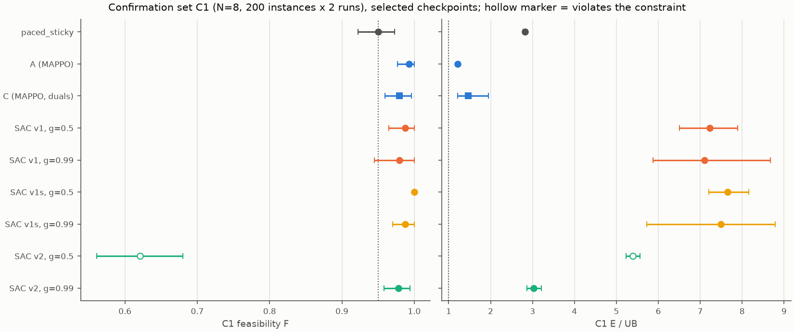
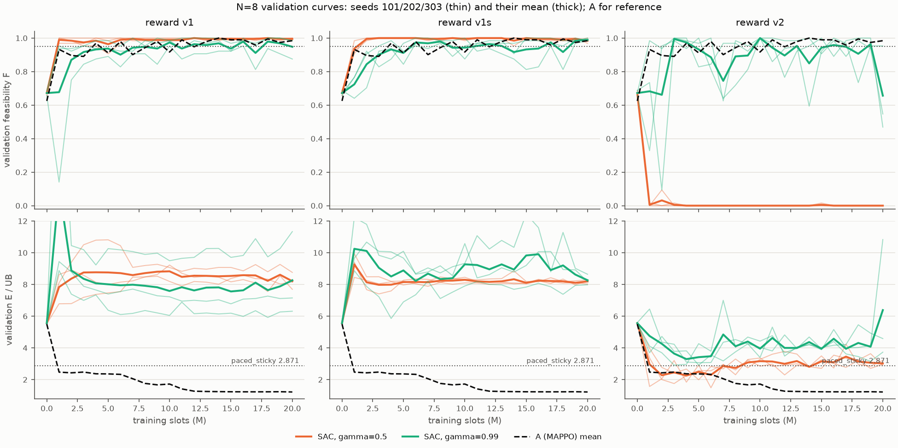

# EXP-DSA05-005：与 XR-SBPC 的正面比较

按已定稿的 [EXP-DSA05-005](../../experiment-designs/005-xr-sbpc-baseline_20260926.md)（第 3 版），在 N = 8 上训练 XR-SBPC 式的 SAC-Discrete 基线：3 种奖励（V1 原文奖励、V1s 去掉塑形、V2 与 A 相同的能耗加违约奖励）× γ ∈ {0.5, 0.99} × 3 个种子，共 18 个运行。之后在备用池新取的确认集 C1（实例 30,000–30,199，每个 2 次执行）上，与 EXP-DSA05-001 第 2b 阶段的 A、C 以及本地基线一起评估一次。这是 C1 第一次被读取。

## 结论（按 §4 预先写定的判读）

**C1 主结果**（选中检查点，3 个训练种子，两层 bootstrap 95% 区间）：

| 方法 | F [95% 区间] | 能耗/上界 [95% 区间] | 与参照基线的配对差 [95% 区间] | 判读 |
|---|---|---|---|---|
| A：MAPPO，固定惩罚 w=10 | 0.993 [0.977, 1.000] | **1.217** [1.209, 1.225] | −1.604 [−1.654, −1.557] | 满足约束，显著节能 |
| C：MAPPO，逐 UE 对偶 η=2 | 0.979 [0.959, 0.996] | 1.467 [1.214, 1.949] | −1.354 [−1.632, −0.882] | 满足约束，显著节能 |
| SAC V1，γ=0.5 | 0.988 [0.965, 1.000] | 7.222 [6.505, 7.899] | +4.401 [+3.687, +5.078] | 满足约束，能耗显著高于基线 |
| SAC V1，γ=0.99 | 0.979 [0.945, 1.000] | 7.101 [5.876, 8.669] | +4.280 [+3.055, +5.835] | 满足约束（均值），能耗显著高于基线 |
| SAC V1s，γ=0.5 | 1.000 [1.000, 1.000] | 7.655 [7.204, 8.161] | +4.834 [+4.384, +5.311] | 满足约束，能耗显著高于基线 |
| SAC V1s，γ=0.99 | 0.988 [0.970, 1.000] | 7.487 [5.719, 8.786] | +4.666 [+2.914, +5.967] | 满足约束，能耗显著高于基线 |
| SAC V2，γ=0.5 | 0.621 [0.561, 0.680] | 5.390 [5.232, 5.561] | — | **不满足约束**（选中的是未训练的初始策略） |
| SAC V2，γ=0.99 | 0.978 [0.958, 0.994] | 3.028 [2.863, 3.212] | +0.207 [+0.044, +0.388] | 满足约束，能耗显著高于基线 |
| 参照 paced_sticky（margin=0.5） | 0.950 [0.922, 0.973] | 2.821 [2.772, 2.870] | — | 恰好满足约束（400 个回合中 380 个可行） |

1. **满足约束**：除 V2（γ=0.5）外，所有方法的选中检查点都满足 F ≥ 0.95。V1（γ=0.99）的区间下限为 0.945，低于 0.95；按规则以均值判读。参照基线恰好在门限上。
2. **与参照基线**：A、C 显著节能。所有 SAC 变体的能耗都**显著高于**参照基线，包括用我们奖励训练的 V2（γ=0.99），它比基线高 0.207 [+0.044, +0.388]。
3. **Q1 主分析（γ=0.99，同一 SAC 方案）**：三者都满足约束。
   - V1 − V2 = +4.073 [+2.838, +5.634]；
   - V1s − V2 = +4.459 [+2.689, +5.737]；
   - 可行率之差都接近 0（V1 − V2 为 +0.001 [−0.035, +0.032]，V1s − V2 为 +0.009 [−0.008, +0.027]）。

   两种可靠性奖励相对 V2 的方向一致，按规则判定：**在同一 SAC 方案、γ=0.99 下，把 XR-SBPC 的可靠性奖励换成能耗加违约奖励，能耗/上界降低约 4，可行率没有可分辨的变化。**
4. **Q1 敏感性分析（γ=0.5）**：V2 在 γ=0.5 下学不起来（选中的是初始策略，F=0.621），能耗差不作判读。可行率之差为 V1 − V2 = +0.367、V1s − V2 = +0.379。所以 Q1 的奖励效应**依赖 γ**：短视的折扣下，能耗奖励连约束都满足不了。
5. **调参后的实际表现**（按种子 101 的验证集选 γ）：V1 选 γ=0.5（7.222），V1s 选 γ=0.5（7.655），V2 选 γ=0.99（3.028）。只作描述。
6. **Q2（完整方案）**：调参后的 V2 − A = +1.811 [+1.648, +1.999]，可行率之差 −0.014 [−0.036, +0.007]。**A 的训练方案显著更好**：V2 的能耗约为 A 的 2.5 倍。V2 调参后选定的正是 γ=0.99，所以补充分析（γ=0.99 的 V2 − A）与主分析相同。按预先规定，这一差别只归于整套训练方案（学习算法、网络、价值函数、经验回放、探索与折扣的组合，见设计 §2.4），不归于其中任何单一部分。
7. **Q3（塑形的作用）**：V1 − V1s 在 γ=0.99 下为 −0.386 [−2.347, +1.651]，在 γ=0.5 下为 −0.432 [−1.157, +0.201]，都没有显著差异。诊断（§4）显示两者的行为几乎相同：高功率、几个时隙内发完。塑形项的影响很小，V1 每包只多用约 0.1–0.5 个发送时隙。设计中担心的"慢慢拖到截止期"没有出现。
8. **复验 EXP-DSA05-004**（C1 对测试集）：A 1.217 对 1.213，C 1.467 对 1.463，参照基线 2.821 对 2.798；A、C 仍显著节能，A − C 仍无显著差异（−0.251 [−0.734, +0.003]，测试集为 −0.251 [−0.737, +0.005]）。**EXP-DSA05-004 的结论在独立确认集上复现。**
9. **样本效率**（验证集，描述性）：没有任何 SAC 运行在任一验证点同时做到 F ≥ 0.95 且能耗/上界低于 2.871；A 在 100 万–400 万时隙就做到了。

## 1. 设置与来源

| 项目 | 内容 |
|---|---|
| 设计 | [EXP-DSA05-005](../../experiment-designs/005-xr-sbpc-baseline_20260926.md)，定稿提交 `fe6182a`；第 0 阶段 `b90654c` |
| 训练 | 18 个运行，`--formal`，提交 `4e38cba`，工作区干净；每个 2000 万时隙、1,249,922 次更新、21 个检查点；18 个并行，每个用时 16.6–18.8 小时 |
| 耗时估计的更正 | 第 0 阶段按单个运行的冒烟结果估计每个运行约 10 小时。机器只有 16 个物理核，18 个并行时每个运行的更新变慢约 70%，实际用时 16.6–18.8 小时 |
| C1 参照 | [确认集 C1 的中央参照](../confirm1-references_20260927/report.md)，提交 `b90654c` |
| C1 评估 | `evaluate_marl --split confirm1 --confirm-c1 --formal`，提交 `70fbe81`，工作区干净：24 个训练运行 × 选中与最后检查点，加 4 个本地基线；原始输出 `outputs/exp005-confirm/confirm1-n8.json`（Git 忽略） |
| 判读 | [confirm1-summary.json](confirm1-summary.json)、[confirm1-results.png](confirm1-results.png)，由 [`scripts/summarize_exp005_confirm.py`](../../../scripts/summarize_exp005_confirm.py)（提交 `c355c72`，早于 C1 评估）生成 |
| 验证侧分析 | [validation-analysis.json](validation-analysis.json)、[validation-curves.png](validation-curves.png)，由 [`scripts/analyze_exp005.py`](../../../scripts/analyze_exp005.py) 生成 |
| 行为诊断 | [diagnosis-A.json](diagnosis-A.json)、[diagnosis-v1.json](diagnosis-v1.json)、[diagnosis-v1s.json](diagnosis-v1s.json)、[diagnosis-v2.json](diagnosis-v2.json)：64 个验证实例，重放选中检查点，提交 `70fbe81`，工作区干净 |

执行顺序与设计一致：设计定稿 → 第 0 阶段 → C1 参照 → 训练与选模 → 提交判读脚本 → 在 C1 上评估一次。C1 评估之前，工作区出现了未跟踪的论文初稿目录 `manuscript/`，按用户的决定原样提交（`70fbe81`）后再运行；它不影响任何代码。



## 2. 完整结果

### 2.1 C1 上的逐种子结果（选中检查点，F / 能耗/上界）

| 方法 | 种子 101 | 种子 202 | 种子 303 |
|---|---|---|---|
| A | 0.980 / 1.215 | 0.998 / 1.211 | 1.000 / 1.224 |
| C | 0.965 / 1.953 | 0.980 / 1.213 | 0.993 / 1.236 |
| V1，γ=0.5 | 1.000 / 7.517 | 0.993 / 6.458 | 0.970 / 7.692 |
| V1，γ=0.99 | 0.948 / 8.803 | 0.990 / 5.842 | 1.000 / 6.657 |
| V1s，γ=0.5 | 1.000 / 7.804 | 1.000 / 7.877 | 1.000 / 7.283 |
| V1s，γ=0.99 | 0.983 / 8.570 | 0.985 / 5.668 | 0.995 / 8.223 |
| V2，γ=0.5 | 0.625 / 5.431 | 0.608 / 5.346 | 0.630 / 5.393 |
| V2，γ=0.99 | 0.983 / 3.040 | 0.985 / 2.882 | 0.968 / 3.161 |

### 2.2 最后检查点（描述性）

| 方法 | F | 能耗/上界 |
|---|---|---|
| A | 0.984 | 1.223 |
| C | 0.913 | 1.490 |
| V1，γ=0.5 / 0.99 | 0.998 / 0.965 | 7.898 / 8.018 |
| V1s，γ=0.5 / 0.99 | 1.000 / 0.988 | 7.835 / 8.140 |
| V2，γ=0.5 / 0.99 | 0.000 / 0.636 | 2.876 / 6.333 |

V2 在 γ=0.99 下训练不稳定：选中的检查点在 300 万–700 万时隙，此后验证 F 反复下跌，最后检查点的 F 只有 0.48–0.90（逐种子）。γ=0.5 的 V2 训练后迅速变成"省电但大量违约"，所有训练后的检查点在验证集上 F 都接近 0，选模规则因此退回初始策略。

### 2.3 其他本地基线

random_max 1.000 / 9.106，sticky_max 1.000 / 10.114，lazy_pacing 0.302 / 5.645（F / 能耗/上界），与测试集上的表现一致。

## 3. 验证集：调参、样本效率与学习曲线



| 奖励 | 调参后 γ | 种子 101 的入选候选 | 验证 F | 验证能耗/上界 |
|---|---|---|---|---|
| V1 | 0.5 | 1800 万时隙 | 1.000 | 7.555 |
| V1s | 0.5 | 500 万时隙 | 1.000 | 7.967 |
| V2 | 0.99 | 500 万时隙 | 1.000 | 3.068 |

**样本效率**：
- 18 个 SAC 运行都没有在任何验证点同时满足 F ≥ 0.95 与能耗/上界 < 2.871。
- A 的 3 个种子分别在 200 万、400 万、100 万时隙达到这一点；能耗/上界降到 1.5 以下分别在 700 万、900 万、1200 万时隙。
- SAC 中唯一"降到 1.5 以下"的是 V2（γ=0.5）种子 101 在 600 万时隙的检查点，但那时 F = 0，没有意义。按设计的定义照录。

## 4. 行为诊断（64 个验证实例，重放选中检查点）

| 策略 | 能耗/下界 | 占空比 | 冲突率 | 干扰损失 | 功率档占比（5/10/15/19/23 dBm） |
|---|---|---|---|---|---|
| A（3 个种子） | 1.37–1.39 | 0.61–0.76 | 0.19–0.24 | 0.06–0.07 | 约 0.40 / 0.44 / 0.16 / 0 / 0 |
| V1，γ=0.5 | 7.2–8.4 | 1.00 | 0.24–0.28 | 0.18–0.20 | 0 / 0 / 0–0.24 / 0.25–0.33 / 0.50–0.75 |
| V1，γ=0.99 | 6.3–9.7 | 1.00 | 0.38–0.48 | 0.28–0.37 | 0 / 0 / 0–0.48 / 0.22–0.69 / 0.31–0.55 |
| V1s，γ=0.5 | 7.7–8.2 | 1.00 | 0.11–0.18 | 0.09–0.14 | 0 / 0 / 0 / 0.03–0.20 / 0.80–0.97 |
| V1s，γ=0.99 | 6.1–8.9 | 1.00 | 0.33–0.39 | 0.24–0.29 | 0 / 0 / 0–0.29 / 0.42–0.49 / 0.22–0.58 |
| V2，γ=0.5（初始策略） | 5.9 | 0.95 | 0.46–0.47 | 0.27 | 各约 0.20 |
| V2，γ=0.99 | 3.2–3.4 | 1.00 | 0.58–0.68 | 0.38–0.40 | 0 / 0.40–0.55 / 0.36–0.53 / 0.05–0.09 / 0 |
| paced_sticky | 3.19 | 1.00 | 0.59 | 0.37 | 0.44 / 0.30 / 0.18 / 0.05 / 0.03 |
| 中央上界调度 | 1.14 | 0.69 | 0 | 0 | 0.32 / 0.64 / 0.04 / 0 / 0 |

**逐包指标**（§3.3）：

| 策略 | 每包发送时隙 | 完成时刻占周期 | 过期比例 | 每包累计中途奖励（按 V1 公式） | 未完成时隙的 R/φ 中位数 / p90 |
|---|---|---|---|---|---|
| A | 7.5–7.9 | 0.62–0.75 | ≤ 0.001 | −4 至 46 | 1.7–2.1 / 3.8–5.2 |
| V1，γ=0.5 | 3.0–3.4 | 0.19–0.23 | ≤ 0.0002 | 78–95 | 7.2–7.9 / 15.7–16.2 |
| V1，γ=0.99 | 3.7–4.1 | 0.25–0.27 | ≤ 0.004 | 87–108 | 5.0–6.6 / 13.2–14.5 |
| V1s，γ=0.5 | 2.5–2.7 | 0.16–0.17 | 0 | 70–71 | 7.8–8.2 / 16.3–16.8 |
| V1s，γ=0.99 | 3.6–4.0 | 0.24 | ≤ 0.0012 | 78–82 | 4.6–5.7 / 12.0–13.9 |
| V2，γ=0.99 | 7.4–8.7 | 0.46–0.51 | ≤ 0.001 | 77–92 | 1.7–2.4 / 5.9–7.0 |
| 中央上界调度 | 8.0 | 0.67 | 0 | 51 | 1.9 / 4.7 |

- **V1、V1s**：有包就以 19/23 dBm 连续发送，在周期的前 16%–27% 就发完。这是"只求可靠、不计能耗"的最优反应，能耗约为下界的 6–10 倍。设计中担心的"缓慢拖延"没有出现。V1 比 V1s 每包多用约 0.1–0.5 个时隙、多拿约 10–25 的中途奖励（按 V1 公式计），属于轻微的"分块"，但对能耗没有显著影响（Q3）。
- **V2，γ=0.99**：学会了用 10/15 dBm 这样的中等功率摊开发送（每包 7–9 个时隙，与 A 相近）。但它从不主动沉默让路：占空比为 1，冲突率 0.58–0.68、干扰损失约 0.4，与 paced_sticky 相当。所以能耗停在基线附近。
- **A**：同样摊开发送，但占空比只有 0.61–0.76，冲突率 0.19–0.24，功率以 5/10 dBm 为主。A 相对 V2 的优势，主要来自学会了在时间上错开发送。
- 训练日志与此一致：V2（γ=0.99）的温度在训练后期接近 0，策略熵约 0.15，高于目标值 0.05，发送占有包时隙的比例为 0.95–0.99。

## 5. 对论文的含义

- **对审稿人"为什么不与 XR-SBPC 比较"的回答**：在 DSA05 中按 XR-SBPC 的方法实现的基线，无论用原文奖励还是去掉塑形的版本，都能满足约束，但能耗是 A 的 5.8–6.3 倍，约为本地规则 paced_sticky 的 2.5–2.7 倍。原因是可靠性奖励不给省电任何激励（Q1）。
- **奖励之外还有训练方案的差别**：同样用我们的能耗加违约奖励，XR-SBPC 式的 SAC 方案只学到"中等功率、持续发送"，能耗仍是 A 的 2.5 倍（Q2），也没有优于本地基线。A 的方案学会了在时间上错开发送。按预先规定，这只能归于整套方案，不能说是 PPO、循环网络或集中式 Critic 中的哪一个起了作用。如果论文要讨论哪个组成部分关键，需要另做消融。
- **EXP-DSA05-004 的主结论在独立确认集上复现**，数值几乎一致，可以在论文中作为稳健性证据。
- **需要如实写明的局限**：
  - 这是按 XR-SBPC 方法思路在 DSA05 中实现的基线，不是原文复现：原文参数有不一致，没有公开代码，信息条件做了匹配（去掉邻居动作与即时信道），空闲转移的处理也做了修正；
  - 只调了 γ 两个取值，超参数沿用原文场景，SAC 基线可能被低估；
  - V2 在 γ=0.99 下训练不稳定，选中检查点依赖验证集选模。

## 6. 边界

- 只做了 N = 8。
- 每种设置 3 个训练种子。
- 参照基线在 C1 上的可行率恰好为 0.950（380/400），与"是否满足约束"的门限重合；若多一个不可行回合，第 2 条中与基线相关的判读将不再适用。
- 行为诊断在验证集上计算，是描述性的。
- 能耗只计发射能耗（场景 v1.0 的冻结假设）。

## 7. 复现

```bash
# 训练：在提交 4e38cba 上
for profile in v1-g05 v1-g099 v1s-g05 v1s-g099 v2-g05 v2-g099; do for seed in 101 202 303; do
  uv run --locked python -m dsa_period.experiments.train_sac_baseline \
    --scenario configs/scenario-v1-n8.toml --profile $profile --seed $seed \
    --output outputs/exp005/n8-$profile-seed$seed --formal
done; done
# C1 评估：在提交 70fbe81 上
uv run --locked python -m dsa_period.experiments.evaluate_marl \
  --scenario configs/scenario-v1-n8.toml \
  --runs $(ls -d outputs/exp005/n8-*/) $(ls -d outputs/exp001-phase2b/n8-*/) --checkpoints both \
  --baselines paced_sticky:margin=0.5 random_max sticky_max lazy_pacing \
  --reference paced_sticky:margin=0.5 --split confirm1 --confirm-c1 --formal \
  --output outputs/exp005-confirm/confirm1-n8.json
# 验证侧分析与判读：在本报告所在的提交上
uv run --locked python scripts/analyze_exp005.py $(ls -d outputs/exp005/n8-*/) \
  --reference $(ls -d outputs/exp001-phase2b/n8-*/) --output <路径>/validation-analysis.json \
  --figure <路径>/validation-curves.png
uv run --locked python scripts/summarize_exp005_confirm.py outputs/exp005-confirm/confirm1-n8.json \
  --analysis <路径>/validation-analysis.json --exp004 docs/results/exp004-test_20260926/summary.json \
  --output <路径>/confirm1-summary.json --figure <路径>/confirm1-results.png
# 诊断：在提交 70fbe81 上，每组各运行的选中检查点（见 diagnosis-*.json 中的 checkpoints 字段）
OMP_NUM_THREADS=1 uv run --locked python scripts/diagnose_exp001_efficiency.py \
  --scenario configs/scenario-v1-n8.toml --instances 64 --checkpoint NAME=PATH ... \
  --output <路径>/diagnosis-<组>.json
```
